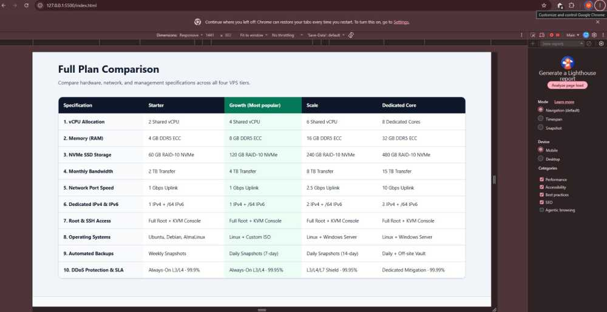
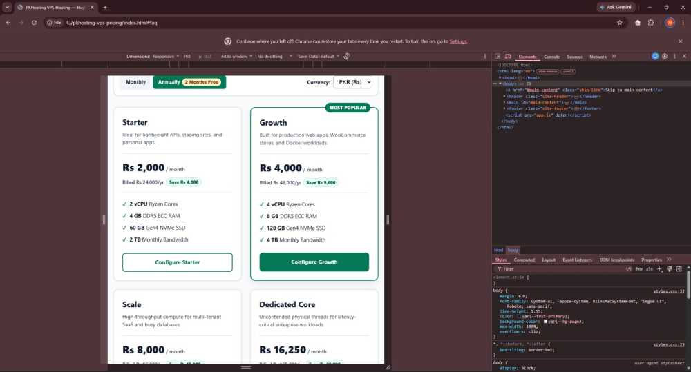
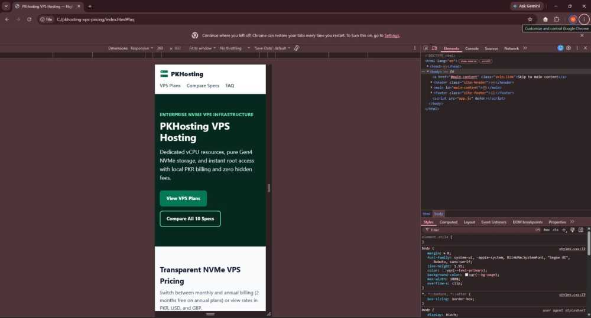
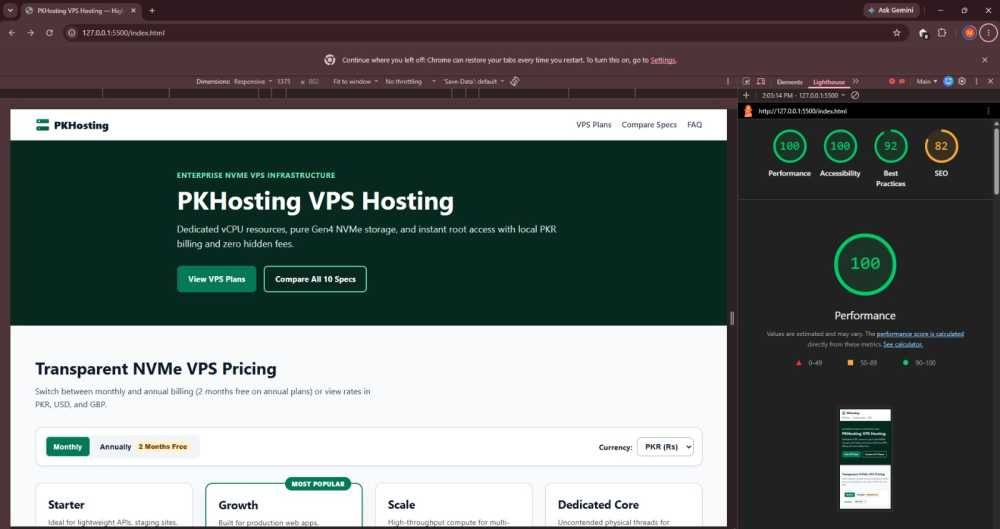

# PKHosting VPS Hosting — Responsive Pricing Page

A self-contained, offline-capable, accessible VPS pricing page built with semantic HTML5, modern CSS, and vanilla JavaScript for the TechAbout Web Developer assessment.

## How to Open & Run
1. **Direct Offline Open (Zero Setup):** Double-click `index.html` or open it directly in any modern browser (`file:///.../index.html`). No build step, package manager, or internet connection is required.
2. **Optional Local Server:**
   ```bash
   python -m http.server 8080
   ## AI Assistant Disclosure
In accordance with the assessment guidelines, I used an AI coding assistant (Google Gemini) to help structure the initial HTML/CSS/JS scaffolding, verify edge cases against accessibility and Content-Security-Policy requirements, and refine documentation outlines. All pricing calculations, responsive layout adjustments, browser checks (Chrome and Firefox), and Lighthouse audits were manually reviewed, tested, and verified by me so I can explain and modify any part of the codebase live.
## Responsive Screenshots & Lighthouse Audit

### Desktop View (1440px)


### Tablet View (768px)


### Mobile View (360px)


### Chrome Lighthouse Audit

